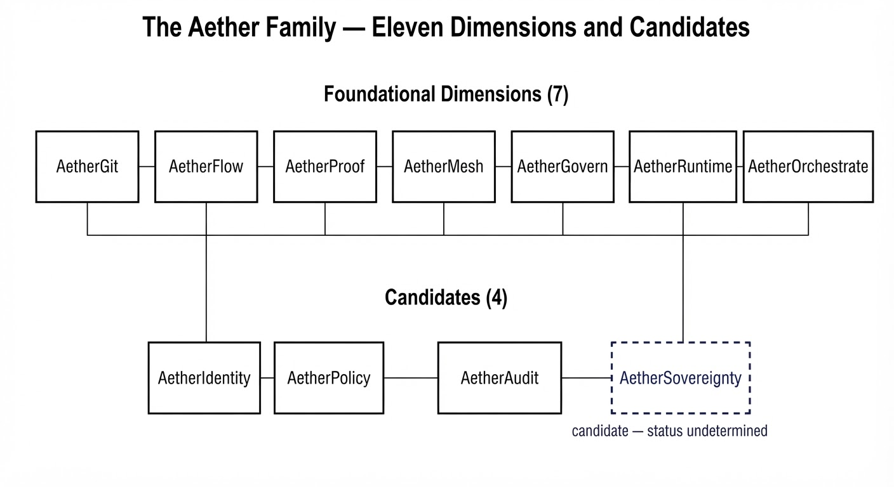
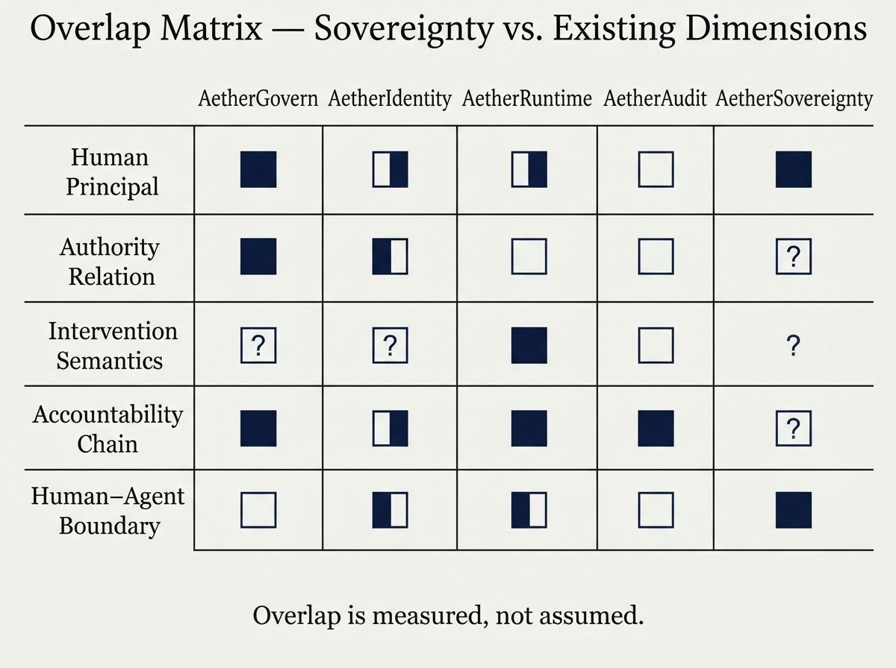
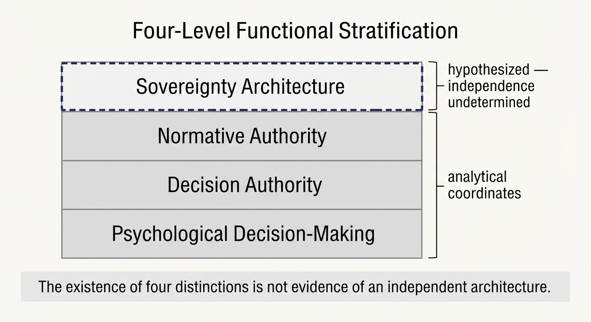
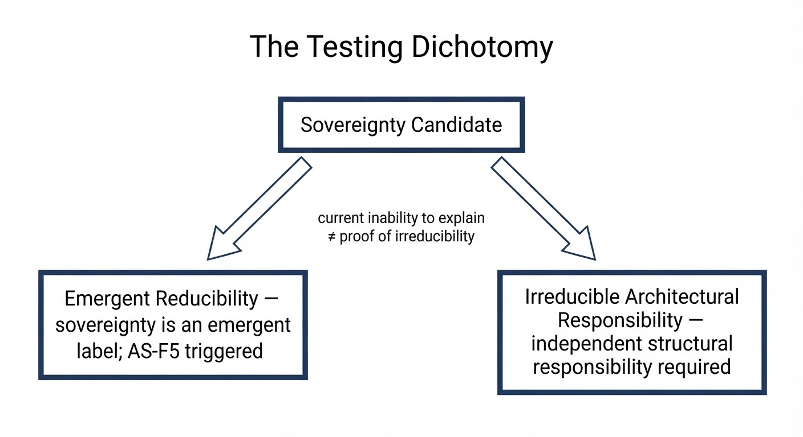
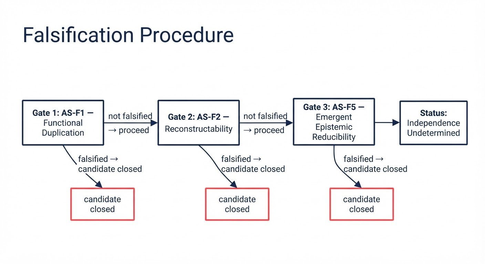
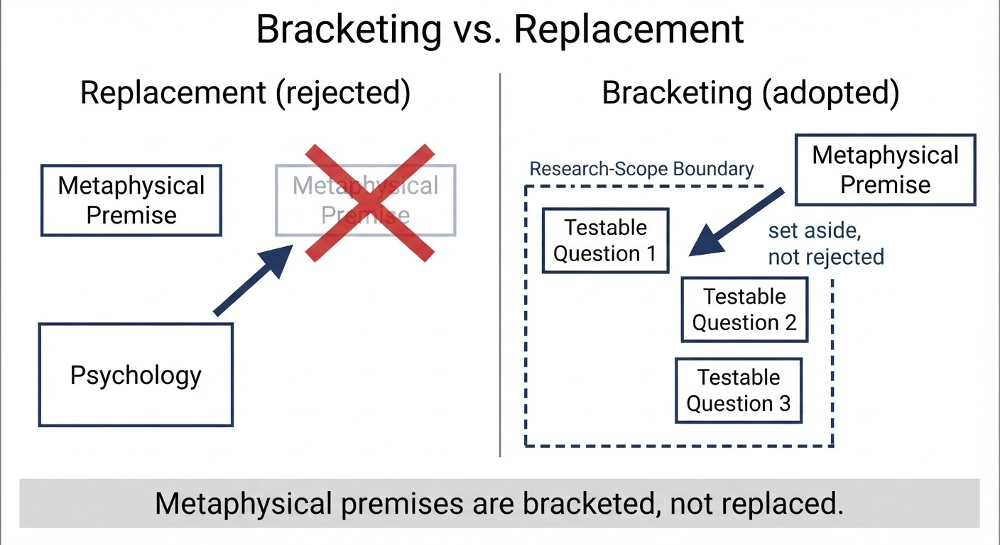
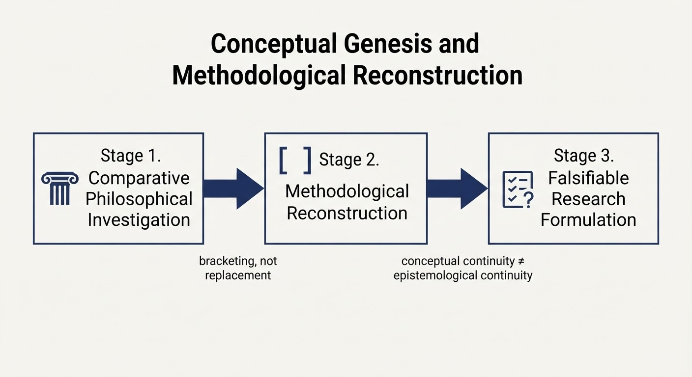
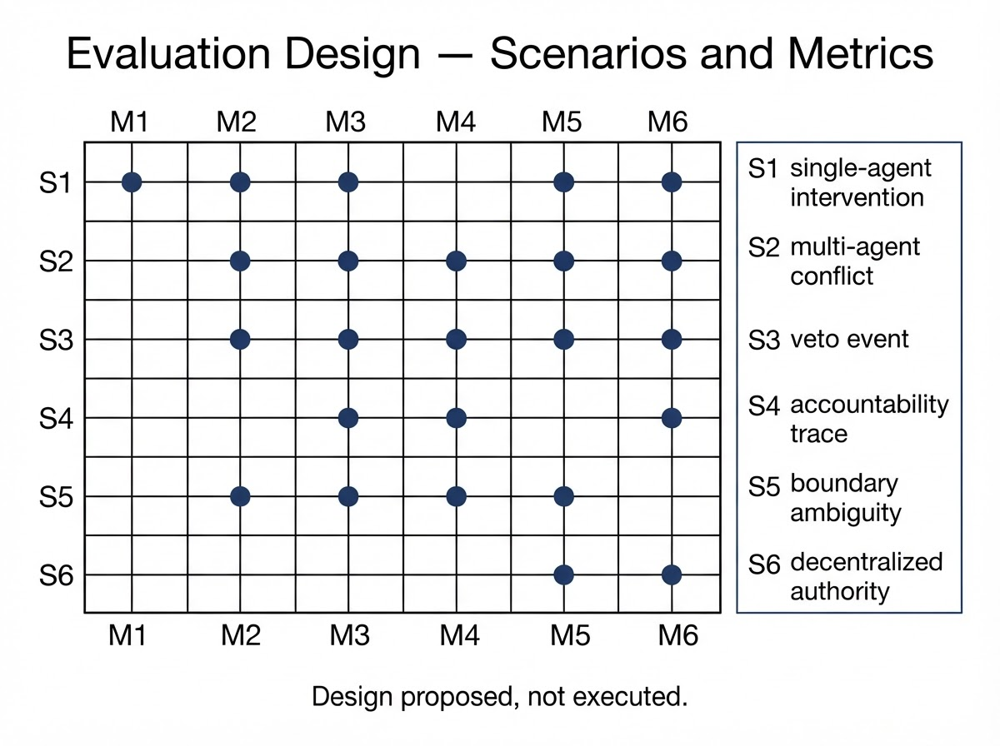
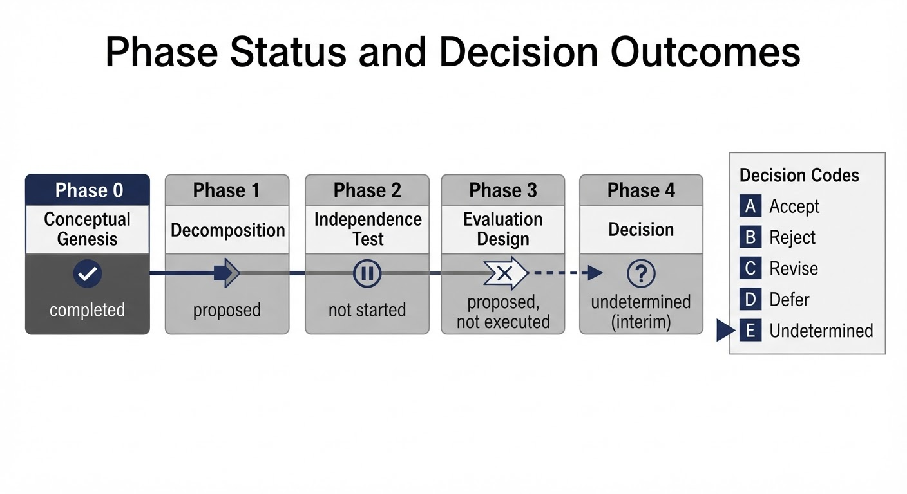

<div align="center">

# AetherSovereignty — Research Repository

### The Architectural Independence of Sovereignty in Autonomous Agent Systems

*A Falsification-First Investigation of Authority Topology, Normative Reference, and Veto Structure*

<br>

[](https://doi.org/10.5281/zenodo.24433970)
[](https://doi.org/10.6084/m9.figshare.35091439)
[](https://aethersovereignty.netlify.app)
[](https://creativecommons.org/licenses/by/4.0/)
[](https://orcid.org/0009-0003-8903-0029)


<br>

**[Website](https://aethersovereignty.netlify.app)** · **[Paper (PDF)](paper/AetherSovereignty_Research_Paper_v1.0.0.pdf)** · **[Zenodo](https://doi.org/10.5281/zenodo.24433970)** · **[Figshare](https://doi.org/10.6084/m9.figshare.35091439)** · **[Status](records/methodological_status_record.md)**

<br>

> ***"AetherSovereignty is a candidate, not a result."***

</div>

---

> [!IMPORTANT]
> **Status:** Phase 0 (Conceptual Genesis and Methodological Reconstruction — Complete). This is a **research repository, not a software repository**. No implementation is authorized.
>
> **Decision:** **(E) Undetermined (interim).**
>
> **Structural dependency:** AetherSovereignty depends on the resolution of AetherGovern (foundational, unresolved) and AetherIdentity (candidate, unresolved).

---

## Table of Contents

- [Overview](#overview)
- [Central Question](#central-question)
- [Four-Level Functional Stratification](#four-level-functional-stratification)
- [Testing Dichotomy](#testing-dichotomy)
- [Falsification Criteria](#falsification-criteria)
- [Propositions P1 and P2](#propositions-p1-and-p2)
- [Conceptual Genesis](#conceptual-genesis)
- [Evaluation Design](#evaluation-design)
- [Decision](#decision)
- [Repository Structure](#repository-structure)
- [Investigation Status](#investigation-status)
- [What This Repository Does Not Claim](#what-this-repository-does-not-claim)
- [Related Work](#related-work)
- [Related Aether Projects](#related-aether-projects)
- [Threats to Validity](#threats-to-validity)
- [Citation](#citation)
- [Author](#author)
- [License](#license)

---

## Overview

**AetherSovereignty** is the **eleventh candidate** of the Aether family. It investigates whether a genuine architectural gap exists between **sovereignty** — the structural responsibility that organizes authority, normative reference, and veto relations — and the existing dimensions, in particular:

| Dimension | Concern |
|---|---|
| **AetherGovern** | Rules and coordination |
| **AetherIdentity** | Persistent agent identity |
| **AetherRuntime** | Execution environment |

> **AetherSovereignty is not a replacement for any of these.** All remain dimensions or candidates with their own status. The investigation asks only whether the structural organization of authority relations is a distinct responsibility that cannot be reduced to the existing dimensions.

<p align="center">
  
  <br>
  <sub><b>Figure 1.</b> The Aether family — eleven dimensions and candidates.</sub>
</p>

This repository contains **no** `src/`, `tests/` or `experiments/`. It **does** contain a conceptual genesis, methodological reconstruction, and an evaluation design proposal. The figures of the paper are in `docs/figure/`.

| | |
|---|---|
| **Current release** | v1.0.0 — [Zenodo](https://doi.org/10.5281/zenodo.24433970) · [Figshare](https://doi.org/10.6084/m9.figshare.35091439) |
| **Paper** | 16 sections + 3 appendices · ~7,200 words · 9 figures · 7 tables · 25 references |
| **PDF in this repo** | [`paper/AetherSovereignty_Research_Paper_v1.0.0.pdf`](paper/AetherSovereignty_Research_Paper_v1.0.0.pdf) |
| **Website** | [aethersovereignty.netlify.app](https://aethersovereignty.netlify.app) |

---

## Central Question

> Does sovereignty — the structural responsibility that organizes authority, normative reference, and veto relations within an autonomous agent system — constitute an independent architectural dimension, or is it merely an emergent descriptive label for the interaction of existing dimensions?

The question has four clauses, each mapped to a failure condition:

| Clause | Requirement | Condition |
|---|---|:-:|
| (i) | Not already covered by Govern / Identity / Runtime | **AS-F1** |
| (ii) | Does not decompose into Govern + Identity + Runtime | **AS-F2** |
| (iii) | No central sovereignty authority required | **AS-F3** (embedded in H3) |
| (iv) | No irreducible epistemic or architectural addition missing | **AS-F5** |

A positive answer needs **all four**. A negative answer on **any one** is sufficient to reject the candidate as a separate dimension.

<p align="center">
  
  <br>
  <sub><b>Figure 8.</b> Overlap matrix — sovereignty vs. existing dimensions. Overlap is measured, not assumed.</sub>
</p>

---

## Four-Level Functional Stratification

| Level | Name | Primary concern |
|:-:|---|---|
| **L1** | Psychological Decision-Making | How decisions are generated |
| **L2** | Decision Authority | How conflicts are resolved |
| **L3** | Normative Authority | Where criteria originate |
| **L4** | Sovereignty Architecture | How L1–L3 are structurally related (hypothesized) |

These four are **not** assumed to be complete, independent or necessary. They serve strictly as analytical coordinates.

<p align="center">
  
  <br>
  <sub><b>Figure 3.</b> Four-level functional stratification (L1–L4).</sub>
</p>

---

## Testing Dichotomy

| Hypothesis | Statement | Status |
|:-:|---|:-:|
| **H1 — Emergent Reducibility** | Sovereignty is an emergent descriptive label for the interaction of established psychological and architectural processes. | 🟡 **Untested** |
| **H2 — Irreducible Architectural Responsibility** | A structural responsibility exists that cannot be fully reconstructed from the interaction of existing dimensions. | 🟡 **Untested** |

> [!NOTE]
> **"Untested" is not a pass.** It states that the hypothesis has been specified but that no verdict has been issued.

<p align="center">
  
  <br>
  <sub><b>Figure 5.</b> The testing dichotomy: emergent reducibility vs. irreducible architectural responsibility.</sub>
</p>

**Decision rule:** the candidate is accepted as an independent dimension only if AS-F5 is falsified (i.e., H2 is supported by a positive specification). The current evidence does not meet that threshold, so the decision remains **(E) Undetermined (interim)**.

---

## Falsification Criteria

| ID | Criterion | Status |
|:-:|---|:-:|
| **AS-F1** | Functional Duplication | 🔴 **NOT FALSIFIED (untested)** |
| **AS-F2** | Reconstructability | 🔴 **NOT FALSIFIED (untested)** |
| **AS-F5** | Emergent Epistemic Reducibility | 🔴 **NOT FALSIFIED (untested)** |

> [!NOTE]
> **"NOT FALSIFIED" is not a pass.** The criteria have been specified; the tests have not been executed.

<p align="center">
  
  <br>
  <sub><b>Figure 6.</b> Falsification procedure: AS-F1 → AS-F2 → AS-F5.</sub>
</p>

---

## Propositions P1 and P2

| # | Proposition | Status |
|:-:|---|:-:|
| **P1** | Determinism of human intervention semantics: given a full specification of an intervention, the semantics are deterministic. | Near-trivial (not machine-checked) |
| **P2** | Irreducible human authority anchor: there exists a human authority anchor that cannot be reduced to existing psychological and architectural processes. | Substantive; cuts against independence (not machine-checked) |

Neither proposition is machine-checked.

---

## Conceptual Genesis

AetherSovereignty originated from a comparative philosophical investigation into the architecture of human authority. Its initial conceptual structure was subsequently reconstructed within the framework of Western psychology and systems architecture.

The metaphysical premises of the original comparative formulation were **bracketed** rather than rejected or replaced. The resulting research formulation sets them aside within the defined scope of investigation, focusing instead on testable questions.

**Conceptual continuity does not imply epistemological continuity.**

<p align="center">
  
  <br>
  <sub><b>Figure 4.</b> Bracketing (adopted) versus replacement (rejected).</sub>
</p>

<p align="center">
  
  <br>
  <sub><b>Figure 2.</b> Conceptual genesis and methodological reconstruction.</sub>
</p>

---

## Evaluation Design

> [!NOTE]
> **Proposal, not executed.** This is a *design*, not a result.

The paper proposes six scenarios (S1–S6) and six metrics (M1–M6).

**Scenarios**

| ID | Scenario | What it tests |
|:-:|---|---|
| **S1** | Single-agent intervention | Baseline: one agent, one intervention |
| **S2** | Multi-agent conflict resolution | Does authority resolution hold across agents? |
| **S3** | Veto event | Does the veto structure exhibit independence? |
| **S4** | Accountability trace | Is the chain of authority traceable? |
| **S5** | Boundary ambiguity | Can the boundary with Govern/Identity be drawn? |
| **S6** | Decentralized authority | Does the formulation preserve decentralization? |

**Metrics**

| ID | Metric | Type |
|:-:|---|---|
| **M1** | Semantic Determinism | Qualitative |
| **M2** | Conflict Resolution Consistency | Quantitative |
| **M3** | Veto Structural Independence | Qualitative |
| **M4** | Trace Completeness | Quantitative |
| **M5** | Boundary Distinguishability | Qualitative |
| **M6** | Decentralization Preservation | Qualitative |

<p align="center">
  
  <br>
  <sub><b>Figure 9.</b> Evaluation design: S1–S6 scenarios and M1–M6 metrics.</sub>
</p>

---

## Decision

> ### AetherSovereignty is classified as **(E) Undetermined (interim)**.
> The evidence is insufficient to accept AetherSovereignty as an independent dimension, and insufficient to reject it.

| Why insufficient to **accept** | Why insufficient to **reject** |
|---|---|
| AS-F1, AS-F2, AS-F5 all untested. | No failure condition has been falsified. |
| H-F4 (observable benefit) untested. | The H-F2 remainder was observed. |
| P1 near-trivial; P2 cuts against independence. | H-F3 did not require centralization. |
| AetherGovern and AetherIdentity unresolved. | The synchronization question is coherent. |

**"Undetermined" is not a failure.** It states that the evidence is insufficient to decide, and names what is missing. Full record: [`records/methodological_status_record.md`](records/methodological_status_record.md).

<p align="center">
  
  <br>
  <sub><b>Figure 7.</b> Phase status and decision outcomes.</sub>
</p>

---

## Repository Structure

```text
AetherSovereignty/
│
├── README.md
├── ARCHITECTURAL_HYPOTHESIS.md
├── ROADMAP.md
├── CHANGELOG.md
├── AUTHORS.md
├── CONTRIBUTING.md
├── INVENTORY.md
├── PROJECT_SUMMARY.txt
├── CITATION.cff
├── VERSION
├── LICENSE
├── manifest.json
├── scientific_state.json
├── netlify.toml
│
├── docs/
│   ├── 01_conceptual_genesis.md
│   ├── 02_four_level_stratification.md
│   ├── 03_falsification_criteria.md
│   └── figure/
│       ├── Fig1_Eleven_Dimensions.png
│       ├── Fig2_Conceptual_Genesis.png
│       ├── Fig3_Four_Levels.png
│       ├── Fig4_Bracketing.png
│       ├── Fig5_Testing_Dichotomy.png
│       ├── Fig6_Falsification_Procedure.png
│       ├── Fig7_Phase_Status.png
│       ├── Fig8_Overlap_Matrix.png
│       └── Fig9_Evaluation_Design.png
│
├── records/
│   └── methodological_status_record.md
│
├── paper/
│   ├── AetherSovereignty_Research_Paper_v1.0.0.md
│   ├── AetherSovereignty_Research_Paper_v1.0.0.pdf
│   ├── AetherSovereignty_Research_Paper_v1.0.0.html
│   ├── style.css
│   ├── generate_pdf.py
│   └── insert_figures.py
│
└── PUBLICATION/
    └── Netlify/
        └── public/
```

No src/, no tests/, no experiments/ — by design.

---

## Investigation Status

| Element | Status |
|---|:-:|
| Conceptual Genesis | ✅ Complete |
| Methodological Reconstruction | ✅ Complete |
| Four-Level Stratification | 🟡 Proposed |
| Independence | ⚠️ Undetermined |
| AS-F1 | 🔴 Not falsified (untested) |
| AS-F2 | 🔴 Not falsified (untested) |
| AS-F5 | 🔴 Not falsified (untested) |
| Falsification | ❌ Not started |
| Phase 0 | ❌ Not authorized |
| Implementation | ❌ Not authorized |
| Decision | 🟡 (E) Undetermined |

---

## What This Repository Does Not Claim

- ✖ That AetherSovereignty is an independent architectural dimension.
- ✖ That the four-level stratification is evidence of four independent components.
- ✖ That the boundaries with AetherGovern and AetherIdentity are sufficient.
- ✖ That the gap is genuine.
- ✖ That implementation should begin.
- ✖ Any observed benefit (AS-F1, AS-F2, AS-F5 are untested).
- ✖ Any causal effect.
- ✖ Any specification of an interface, schema, protocol or prompt.

---

## Related Work

The paper cites the nearest neighbours as reservations on AS-F1, not as support for the candidate.

| Area | References | Role |
|---|---|---|
| Political philosophy | Bodin (1576); Hobbes (1651); Rousseau (1762); Schmitt (1922); Arendt (1958); Pettit (1997) | Background for sovereignty |
| Philosophy of action | Bratman (1987); Habermas (1981); Rawls (1971) | Background for normative authority |
| Principal-agent models | Jensen & Meckling (1976); Eisenhardt (1989) | Background for delegation |
| Multi-agent systems | Wooldridge (2009); Jennings et al. (1998) | Background for agent architecture |
| Human-in-the-loop | Parasuraman et al. (2000); Kaber & Endsley (2004) | Background for intervention |
| Falsification-first | Popper (1959); Lakatos (1978); Kuhn (1962) | Methodology |

The comparison with the field is treated as open and is a reservation on AS-F1.

---

## Related Aether Projects

| # | Project | Status | DOI |
|:-:|---|---|---|
| 1 | AetherGit | Foundational | — |
| 2 | AetherFlow | Foundational | — |
| 3 | AetherProof | Foundational | — |
| 4 | AetherMesh | Foundational | — |
| 5 | AetherGovern | Foundational | — |
| 6 | AetherRuntime | Foundational | — |
| 7 | AetherOrchestrate | Foundational | — |
| 8 | AetherIdentity | Candidate | — |
| 9 | AetherPolicy | Candidate | — |
| 10 | AetherAudit | Candidate | — |
| 11 | **AetherSovereignty** | Candidate (this repository) | [Zenodo](https://doi.org/10.5281/zenodo.24433970) · [Figshare](https://doi.org/10.6084/m9.figshare.35091439) |

---

## Threats to Validity

| # | Threat | Description |
|:-:|---|---|
| T1 | Author-on-author reasoning | The hypothesis and the decision are written by the same author. |
| T2 | No independent review | Phase 2 (independent review) has not started. |
| T3 | Small remainder | The H-F2 remainder may be an artifact of the analysis. |
| T4 | Cooperative-human assumption | The investigation assumes cooperative human principals. |
| T5 | Irreducible trust anchor | An irreducible trust anchor may exist that the four-level stratification does not cover. |
| T6 | No measurement | AS-F1, AS-F2, AS-F5 are untested; no evaluation has been run. |
| T7 | Unresolved Govern and Identity | Boundaries with these dimensions cannot be drawn until they are stabilized. |

---

## Citation

Machine-readable metadata is in [`CITATION.cff`](CITATION.cff), so GitHub shows a **"Cite this repository"** button.

```bibtex
@misc{baladi2026aethersovereignty,
  author    = {Baladi, Samir},
  title     = {AetherSovereignty: The Architectural Independence of Sovereignty in Autonomous Agent Systems},
  year      = {2026},
  version   = {1.0.0},
  publisher = {Zenodo},
  doi       = {10.5281/zenodo.24433970},
  url       = {https://doi.org/10.5281/zenodo.24433970},
  note      = {Alternative DOI: https://doi.org/10.6084/m9.figshare.35091439; Conceptual genesis; (E) Undetermined (interim)}
}
```

---

## Author

**Samir Baladi** — Interdisciplinary AI Researcher, Ronin Institute / Rite of Renaissance

| | |
|---|---|
| **Email** | [gitdeeper@gmail.com](mailto:gitdeeper@gmail.com) |
| **ORCID** | [0009-0003-8903-0029](https://orcid.org/0009-0003-8903-0029) |
| **Website** | [aethersovereignty.netlify.app](https://aethersovereignty.netlify.app) |
| **GitHub** | [gitdeeper15/aethersovereignty](https://github.com/gitdeeper15/aethersovereignty) |
| **GitLab** | [gitlab.com/gitdeeper15/aethersovereignty](https://gitlab.com/gitdeeper15/aethersovereignty) |
| **Codeberg** | [codeberg.org/gitdeeper15/aethersovereignty](https://codeberg.org/gitdeeper15/aethersovereignty) |
| **Bitbucket** | [bitbucket.org/gitdeeper15/aethersovereignty](https://bitbucket.org/gitdeeper15/aethersovereignty) |
| **Zenodo** (v1.0.0, current) | [10.5281/zenodo.24433970](https://doi.org/10.5281/zenodo.24433970) |
| **Figshare** (alternative DOI) | [10.6084/m9.figshare.35091439](https://doi.org/10.6084/m9.figshare.35091439) |

---

## License

CC-BY-4.0 (this document) · MIT (code — future; none in this release).

---

<div align="center">

**AetherSovereignty v1.0.0** — The Architectural Independence of Sovereignty

© 2026 Samir Baladi — Ronin Institute / Rite of Renaissance

Zenodo DOI (v1.0.0): [10.5281/zenodo.24433970](https://doi.org/10.5281/zenodo.24433970) · Figshare DOI: [10.6084/m9.figshare.35091439](https://doi.org/10.6084/m9.figshare.35091439)

***AetherSovereignty is a candidate, not a result.***

</div>
